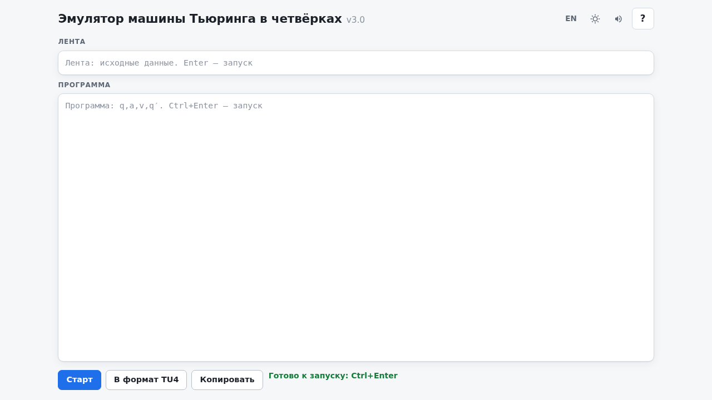
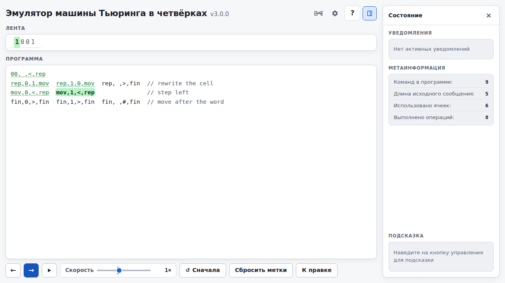
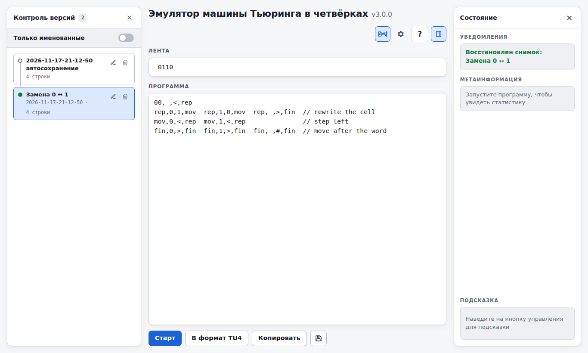
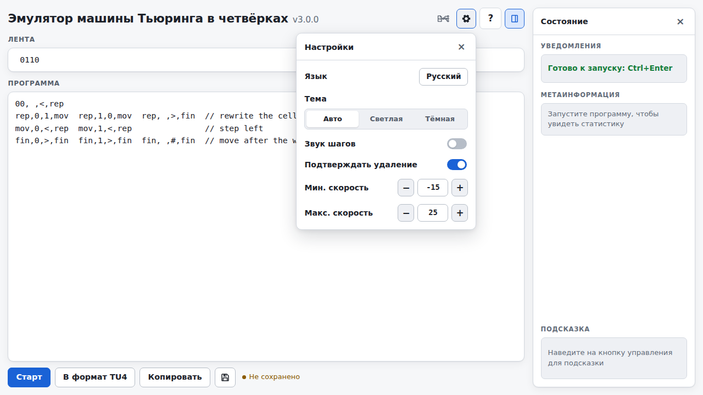
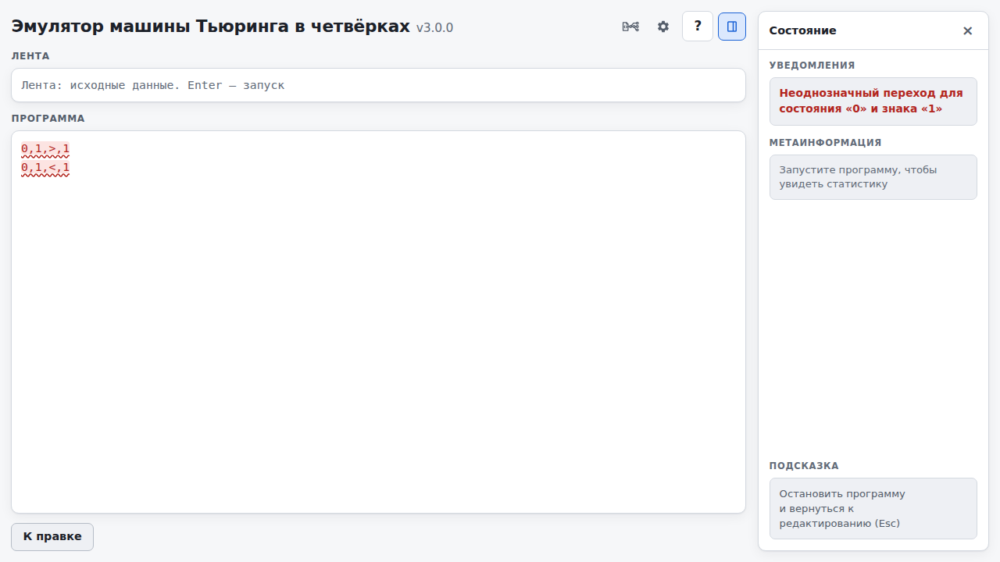
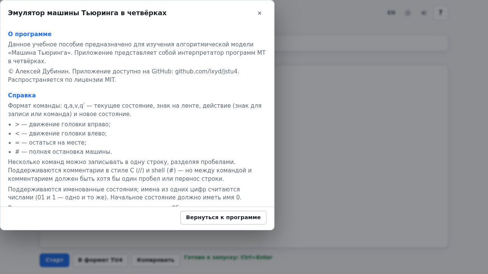
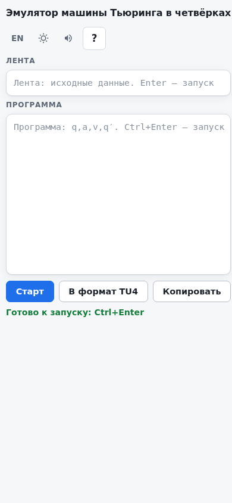
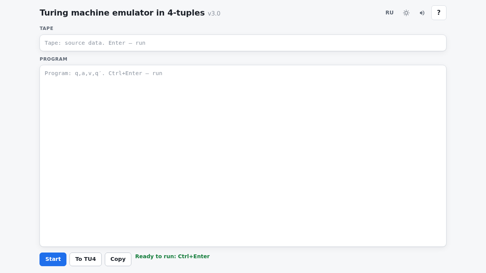
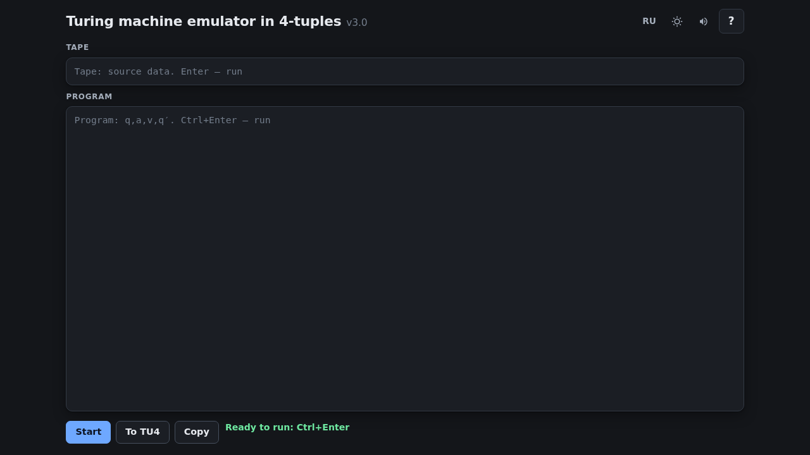
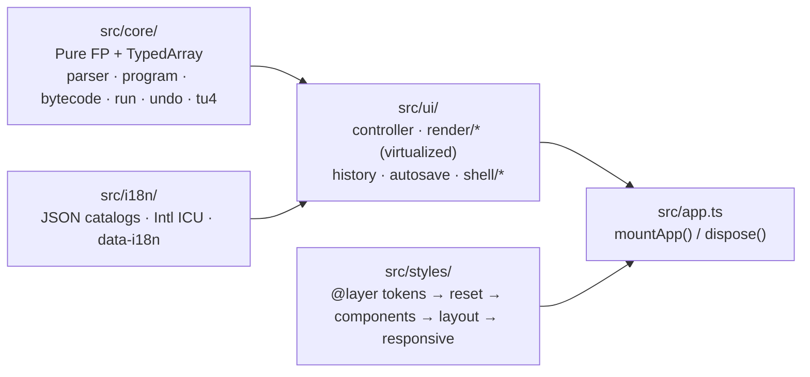

<div align="center">

# jstu4-ng

**Интерактивный эмулятор машины Тьюринга в четвёрках — без рантайм-зависимостей, на строгом TypeScript и нативных веб-стандартах.**

[](https://github.com/Blezz-tech/jstu4-ng/actions/workflows/ci.yml)
[](https://github.com/Blezz-tech/jstu4-ng/actions/workflows/deploy-pages.yml)
[](https://blezz-tech.github.io/jstu4-ng/)
[](./CHANGELOG.md)
[](./package.json)
[](https://www.conventionalcommits.org/en/v1.0.0/)
[](./LICENSE)

**[▶ Открыть эмулятор онлайн](https://blezz-tech.github.io/jstu4-ng/)** ·
[Возможности](#возможности) ·
[Скриншоты](#скриншоты) ·
[Синтаксис МТ](#синтаксис-программ-мт) ·
[Быстрый старт](#быстрый-старт) ·
[Архитектура](#архитектура) ·
[Разработка и CI/CD](#разработка-и-cicd)

<br />

<picture>
  <source media="(prefers-color-scheme: dark)" srcset="./screenshots/edit-dark-ru.png" />
  <source media="(prefers-color-scheme: light)" srcset="./screenshots/edit-light-ru.png" />
  
</picture>

</div>

---

**jstu4-ng** — современная переработка классического учебного эмулятора [jstu4 v2.3](https://github.com/lxyd/jstu4) (© Алексей Дубинин, 2011–2016) для студентов, изучающих теорию алгоритмов. Семантика языка четвёрок, граничные проверки и экспорт в TU4 сохранены на 100%, а движок, рендеринг, интерфейс и инфраструктура переписаны с нуля под стек 2026 года.

## Ключевые достоинства

- **Ноль рантайм-зависимостей и работа офлайн.** Никаких фреймворков — только нативный DOM, CSS `@layer` + `light-dark()`, Web Audio API и `<dialog>`. Production-сборка состоит ровно из **3 статических файлов** (~42 КБ gzip суммарно) и открывается даже напрямую с диска (`file:///.../dist/index.html`) без ошибок CORS.
- **Быстрое ядро на `TypedArray`-байткоде.** Компиляция в плоские таблицы переходов, zero-copy `O(k)` обновления ленты, SoA кольцевой буфер истории до **100 000 шагов** с полноценным обратным ходом (`←` и отрицательной скоростью), оконная виртуализация для больших лент (`> 500` ячеек) и программ (`> 400` строк / `> 800` команд).
- **Удобная отладка и контроль версий.** Встроенная левая панель снимков (ручное сохранение `Ctrl+S`, автоснимки раз в 5 минут и при закрытии вкладки, переименование, фильтр именованных, восстановление), правая панель уведомлений/статистики/подсказок и двусторонний регулятор скорости (по умолчанию `-15×…25×`, настраивается в пределах `-1000×…1000×`).
- **Двуязычность, темы и доступность.** Мгновенное переключение **RU / EN** (ICU-форматтер на нативном `Intl`, deep-link `?lang=en` / `?lang=ru` и `#help`), авто/светлая/тёмная темы (WCAG AA), клавиатурная навигация, `aria-live`, адаптивная мобильная вёрстка и стиль для печати.
- **Инженерная дисциплина.** TypeScript `strict` (`noUncheckedIndexedAccess`, `exactOptionalPropertyTypes`), **201 юнит/DOM-тест** (Vitest) + **31 E2E-сценарий** в реальном Chromium (Playwright), ESLint 10 + Prettier, **SemVer 2.0.0** и **Conventional Commits 1.0.0** в CI.

## Возможности

| Категория               | Подробности                                                                                                                                                                       |
| ----------------------- | --------------------------------------------------------------------------------------------------------------------------------------------------------------------------------- |
| **Язык МТ**             | Четвёрки `q,a,v,q′`, комментарии `//` и `#`, именованные состояния, эквивалентность ведущих нулей (`01 ≡ 1`), полная совместимость с v2.3                                         |
| **Управление запуском** | Шаг вперёд (`→`), шаг назад (`←`, до 100 000 шагов), автозапуск / пауза (`▶` / `■`), двусторонний ползунок скорости (`-15×…25×`, `0×` — стоп, диапазон до `±1000×`), «Сначала»    |
| **Визуальная отладка**  | Текущая команда (зелёная вперёд, жёлтая в реверсе), посещённые команды с откатом при шаге назад, подсветка ошибок разбора и неоднозначных переходов                               |
| **Контроль версий**     | Сворачиваемая левая панель: ручные сохранения (`Ctrl+S` / `Cmd+S`), до 100 автосохранений, переименование с сохранением времени создания, фильтр «Только именованные», удаление   |
| **Панель состояния**    | Сворачиваемая правая панель: лента уведомлений (ошибки, предупреждения, итоги), метрики выполнения (команды, длина, ячейки, операции) и контекстные подсказки по наведению        |
| **Проверки**            | Ошибки синтаксиса, неоднозначные переходы, несуществующие состояния, выход за левую границу ленты, предупреждения «ненормальности» («источник затёрт», «головка не в конце»)      |
| **Экспорт в TU4**       | Модальное окно экспорта в формат `00`–`98` (до 100 состояний) или `00`–`ff` (100–256 состояний) с копированием в буфер без изменения исходного текста программы                   |
| **Настройки**           | Выпадающее меню (шестерёнка): язык (RU/EN), тема (авто/светлая/тёмная), Web Audio звук шагов, мин./макс. скорость, подтверждение удаления снимков — всё хранится в `localStorage` |

## Скриншоты

| Режим выполнения (`run`)                     | Контроль версий (`history`)                          |
| -------------------------------------------- | ---------------------------------------------------- |
|    |  |
| **Меню настроек (`settings`)**               | **Диагностика ошибок (`error`)**                     |
|  |              |

<details>
<summary>Ещё скриншоты: справка, английская версия (светлая/тёмная) и мобильный вид</summary>

<br />

| Справка (`help`)                                       | Мобильный вид (`390×844`)                                              |
| ------------------------------------------------------ | ---------------------------------------------------------------------- |
|               |  |
| **English — Light (`edit-light-en`)**                  | **English — Dark (`edit-dark-en`)**                                    |
|  |                    |

</details>

> [!TIP]
> Все 10 скриншотов в [`screenshots/`](./screenshots) автоматически генерируются в реальном Chromium командой `npm run shots` (или вручную из GitHub Actions через workflow **Update screenshots**).

## Синтаксис программ МТ

Каждая команда записывается в виде четвёрки `q,a,v,q′`:

- `q` — текущее состояние (начальное состояние — `0`, эквивалентно `00`);
- `a` — символ под головкой (пробел обозначает пустую ячейку);
- `v` — действие:
  - `>` — сдвиг головки вправо;
  - `<` — сдвиг головки влево;
  - `=` — остаться на месте;
  - `#` — остановка машины;
  - любой другой символ — запись этого символа в текущую ячейку;
- `q′` — следующее состояние.

### Пример: замена `0 ↔ 1` на ленте ` 0110`

```text
00, ,<,rep
rep,0,1,mov  rep,1,0,mov  rep, ,>,fin  // перезапись текущего бита
mov,0,<,rep  mov,1,<,rep               // сдвиг влево
fin,0,>,fin  fin,1,>,fin  fin, ,#,fin  // возврат головки за результат
```

За 15 шагов слово `0110` превращается в `1001`.

### Горячие клавиши

| Клавиша                        | Действие                                                                               |
| ------------------------------ | -------------------------------------------------------------------------------------- |
| `Ctrl+Enter` / `Cmd+Enter`     | Запустить программу (также `Enter` в поле ленты)                                       |
| `Enter`                        | В режиме выполнения — старт / пауза автовыполнения (`▶` / `■`)                         |
| `Пробел`                       | Выполнить один шаг вперёд (`→`)                                                        |
| `Shift+Пробел`                 | Выполнить один шаг назад (`←`)                                                         |
| `Ctrl+S` / `Cmd+S`             | Сохранить снимок версии в режиме редактирования                                        |
| `Esc`                          | Закрыть диалог / меню / мобильную панель; остановить автозапуск или вернуться к правке |
| `F1` или `?` (вне полей ввода) | Открыть встроенную справку                                                             |

> [!NOTE]
> **Совместимость с jstu4 v2.3 (не баг, а ожидаемое поведение):**
>
> - Лента ограничена слева: если программа начинает работу с `<`, оставьте ведущий пробел в поле ленты (как ` 0110` в примере выше).
> - Пример «замена `0 ↔ 1`» завершается предупреждением «источник затёрт», поскольку выполняет ненормированную замену на месте (исходные данные перезаписываются) — это точное поведение оригинального v2.3.
> - Экспорт TU4 кодирует состояния десятичными `00`–`98` при `< 100` состояниях и шестнадцатеричными `00`–`ff` при `100`–`256` состояниях; исходный текст в редакторе при этом не изменяется.

## Быстрый старт

Требуется **Node.js `^20.19 || ^22.12 || >=24`**.

```bash
git clone https://github.com/Blezz-tech/jstu4-ng.git
cd jstu4-ng
npm ci
npm run dev        # http://localhost:5173
```

### Команды `npm`

| Команда                | Назначение                                                                                |
| ---------------------- | ----------------------------------------------------------------------------------------- |
| `npm run dev`          | Dev-сервер Vite с HMR (`http://localhost:5173`)                                           |
| `npm run build`        | Алиас `build:prod`: `tsc --noEmit` + production-сборка в `dist/` (3 файла, без `.js.map`) |
| `npm run build:dev`    | Development-сборка в `dist/` без минификации и с source maps (`.js.map`)                  |
| `npm run preview`      | Локальный предпросмотр собранного `dist/` (`http://localhost:4173`)                       |
| `npm run test`         | Запуск 201 юнит/DOM-теста (Vitest, 21 набор)                                              |
| `npm run test:watch`   | Vitest в watch-режиме                                                                     |
| `npm run test:e2e`     | 31 сквозной E2E-тест в реальном Chromium (Playwright)                                     |
| `npm run shots`        | Генерация всех 10 скриншотов (`e2e/visual.spec.ts` → `screenshots/*.png`)                 |
| `npm run lint`         | Type-checked ESLint 10                                                                    |
| `npm run lint:fix`     | ESLint с автоисправлением                                                                 |
| `npm run lint:commits` | Проверка сообщений коммитов / заголовков PR по Conventional Commits 1.0.0                 |
| `npm run format`       | Форматирование кода Prettier                                                              |
| `npm run format:check` | Проверка форматирования Prettier                                                          |
| `npm run check`        | Полная локальная проверка: `lint` + `format:check` + `test` + `build:prod`                |

### Автономная работа по `file://`

И `build:prod`, и `build:dev` переписывают итоговый `dist/index.html` в классический `<script defer>` (IIFE) и `<link rel="stylesheet">` без `crossorigin` и `modulepreload`. Собранную папку `dist/` можно передать архивом или открыть напрямую двойным кликом с диска — без веб-сервера и ошибок CORS.

<details>
<summary>Разработка на NixOS (<code>shell.nix</code> + <code>direnv</code>)</summary>

В корне репозитория есть `shell.nix` (на системном `<nixpkgs>`) и `.envrc` (`use nix`) с пробросом системного Chromium для Playwright (`PLAYWRIGHT_LAUNCH_OPTIONS_EXECUTABLE_PATH`):

```bash
direnv allow           # автоподключение окружения при входе в каталог
# или вручную:
nix-shell              # либо: nix develop --impure -f shell.nix
npm ci
npm run check
npm run test:e2e       # Playwright с Chromium из /nix/store
```

</details>

## Архитектура

Код разделён на чистые слои с однонаправленными зависимостями: ядро `src/core/` полностью свободно от DOM и браузерных API.



### Структура репозитория

```text
src/
  core/                       чистое ядро эмулятора без DOM и зависимостей
    result.ts                 Result<T, E>, конструкторы ok/err и assertNever
    errors.ts                 типизированные CompileError / RuntimeError / Tu4Error
    machine.ts                readonly-модель Command, parseStateName, formatCommand
    parser.ts                 O(N) sticky-парсер программы с точными смещениями
    program.ts                валидация и индексация переходов (Map)
    bytecode.ts               компиляция в плоские TypedArray-таблицы переходов
    run.ts                    исполнение машины (zero-alloc step()), проверки «ненормальности»
    undo-history.ts           SoA кольцевой буфер истории шагов (до 100 000 шагов)
    tu4.ts                    экспорт в формат TU4 (00–98 / 00–ff, до 256 состояний)
    version.ts                SemVer-константа TM_VERSION (подставляется из package.json)
  i18n/                       локализация без зависимостей (ru/en JSON, ICU + Intl, data-i18n)
  ui/
    controller.ts             состояние интерфейса, цикл шагов и синхронизация представлений
    auto-runner.ts            планировщик автовыполнения (setTimeout + rAF-батчинг)
    speed.ts, speed-controller.ts   двусторонний регулятор скорости и границы (-1000×…1000×)
    command-tracker.ts        счётчики посещённых команд и курсор отката
    error-reporter.ts         исчерпывающий вывод ошибок компиляции и выполнения
    run-state.ts              вычисление состояния транспортных кнопок
    stats-view.ts             инкрементальный рендерер метрик (#stats)
    notifications.ts          лента уведомлений боковой панели
    history.ts, autosave.ts   хранилище снимков версий и планировщик автосохранения
    audio.ts, clipboard.ts, dom.ts, storage.ts
    render/                   listing, program-lines, virtual-window, tape-renderer, program-renderer
    shell/                    dialogs, dom, history-panel, settings-menu, settings-store,
                              shortcuts, sidepanels, snapshot-item, toolbar
  styles/                     main.css + 11 модулей в CSS @layer с light-dark() токенами
  app.ts, main.ts             корень композиции mountApp() с полным dispose()
scripts/
  check-conventional-commits.js     валидатор Conventional Commits 1.0.0 (без зависимостей)
tests/                        Vitest: 21 набор (201 юнит/DOM-тест) + tests/helpers/
e2e/                          Playwright: app.spec.ts (31 сценарий) + visual.spec.ts (10 скриншотов)
screenshots/                  актуальные PNG-скриншоты интерфейса
public/index.html             единственная HTML-точка входа для Vite
.github/workflows/            ci.yml · deploy-pages.yml · update-screenshots.yml
CHANGELOG.md, LICENSE, REWRITE.md
```

<details>
<summary>Эволюция: что изменилось по сравнению с jstu4 v2.3 (2011–2016)</summary>

Подробный отчёт о миграции находится в [`REWRITE.md`](./REWRITE.md).

| Было в v2.3 (2011–2016)                    | Стало в jstu4-ng v3.0.0 (2026)                                                                                                               |
| ------------------------------------------ | -------------------------------------------------------------------------------------------------------------------------------------------- |
| jQuery 1.6.4 + плагины (~280 КБ JS)        | Нативный DOM, **0 рантайм-зависимостей**, 3 файла (`~98 КБ` JS + `~29 КБ` CSS + `~18 КБ` HTML; **~42 КБ gzip**)                              |
| Шаблоны HotMilk/Milk, сборка HTML строками | JSON-каталоги + `Intl` ICU-форматтер + `createElement`/`textContent` (без `innerHTML` и XSS-поверхности)                                     |
| Переходы в `{}` (риск коллизий прототипа)  | Валидация через `Map` + исполнение на плоских `TypedArray`-байткод-таблицах                                                                  |
| `setInterval` с 2 скоростями (70 / 10 мс)  | Шаг назад `←` (до 100 000 шагов), реверс, «Сначала», двусторонний ползунок скорости `-15×…25×` (до `±1000×`) с отметкой нуля и rAF-батчингом |
| Справка отдельными HTML-страницами         | Нативный модальный `<dialog>` + `F1` / `?` / `#help`, ленивая сборка DOM справки                                                             |
| Без сохранения и версионирования           | `localStorage`: черновик, панель контроля версий (ручные и автоснимки), настройки, тема, язык и звук                                         |
| Фиксированная вёрстка, редиректы RU/EN     | Адаптив, авто/светлая/тёмная темы (WCAG AA, `@layer`, `light-dark()`), RU/EN на лету, сворачиваемые боковые панели, печать, a11y             |

</details>

## Разработка и CI/CD

### GitHub Actions Workflows

| Workflow                                                               | Триггер                                          | Что делает                                                                                                                                            |
| ---------------------------------------------------------------------- | ------------------------------------------------ | ----------------------------------------------------------------------------------------------------------------------------------------------------- |
| [`ci.yml`](./.github/workflows/ci.yml)                                 | `push` / `pull_request` (`dev`, `main`), вручную | Параллельно: проверка **Conventional Commits** (на PR), `npm run check` + проверка 3-файлового `dist/` + `build:dev`, и **Playwright E2E** в Chromium |
| [`deploy-pages.yml`](./.github/workflows/deploy-pages.yml)             | `push` в `main`, вручную                         | Проверяет `npm run check`, верифицирует `dist/` и публикует сайт на [GitHub Pages](https://blezz-tech.github.io/jstu4-ng/)                            |
| [`update-screenshots.yml`](./.github/workflows/update-screenshots.yml) | вручную (`workflow_dispatch`)                    | Запускает `npm run shots` в Chromium и коммитит обновлённые PNG в выбранную ветку                                                                     |

> Для первичной активации GitHub Pages на форке откройте **Settings → Pages → Build and deployment → Source** и выберите **GitHub Actions**.

### Версионирование (SemVer) и Conventional Commits

- **Единый источник версии — `package.json`.** При сборке Vite подставляет `package.json#version` в `TM_VERSION` (`src/core/version.ts`), поэтому версия в интерфейсе (`v3.0.0`) всегда совпадает с пакетом. История релизов ведётся в [`CHANGELOG.md`](./CHANGELOG.md) по формату [Keep a Changelog](https://keepachangelog.com/ru/1.1.0/) и [SemVer 2.0.0](https://semver.org/lang/ru/).
- **Обязательная конвенция коммитов — [Conventional Commits 1.0.0](https://www.conventionalcommits.org/en/v1.0.0/).** Заголовок PR и все коммиты в PR проверяются в CI скриптом `scripts/check-conventional-commits.js` (`npm run lint:commits`):

| Префикс коммита                                                    | Назначение                                       | Влияние на SemVer           |
| ------------------------------------------------------------------ | ------------------------------------------------ | --------------------------- |
| `fix:` / `perf:` / `revert:`                                       | Исправления ошибок, оптимизации, откаты          | **PATCH** (`3.0.0 → 3.0.1`) |
| `feat:`                                                            | Новая обратно-совместимая функциональность       | **MINOR** (`3.0.0 → 3.1.0`) |
| `feat!:` или footer `BREAKING CHANGE:`                             | Ломающие изменения API / формата                 | **MAJOR** (`3.0.0 → 4.0.0`) |
| `docs:`, `style:`, `refactor:`, `test:`, `build:`, `ci:`, `chore:` | Документация, рефакторинг, тесты, инфраструктура | —                           |

Повышение версии при релизе:

```bash
npm version patch   # или minor / major — обновляет package.json, package-lock.json и тег
```

## Лицензия и благодарности

Распространяется по лицензии **MIT** — см. [`LICENSE`](./LICENSE).

- **jstu4-ng:** © Blezz-tech ([github.com/Blezz-tech/jstu4-ng](https://github.com/Blezz-tech/jstu4-ng))
- **Оригинальный jstu4:** © Алексей Дубинин ([github.com/lxyd/jstu4](https://github.com/lxyd/jstu4)) — благодарность за оригинальную идею, учебную спецификацию и формат программ в четвёрках.
